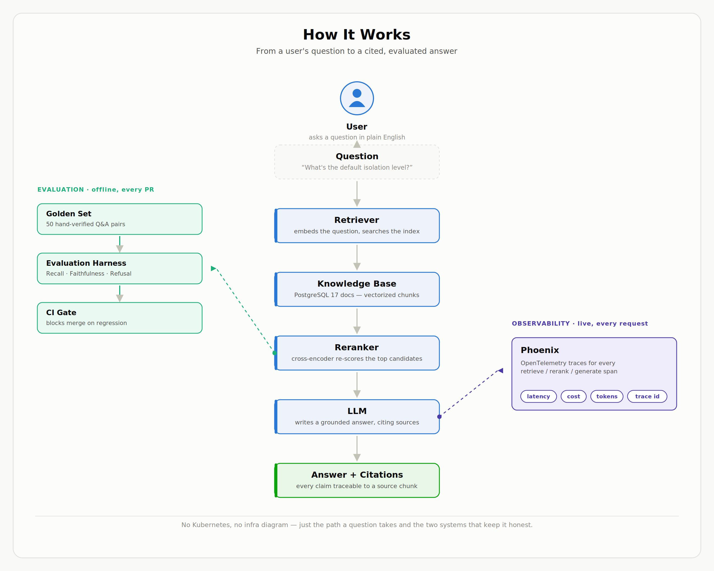

# Anti-Hallucination System

An AI assistant that answers questions from trusted documents, shows its sources for every claim, and says "I don't know" instead of making things up.

## Project Description

AI chatbots are very good at sounding confident, even when they're wrong. When an AI states something false as if it were fact, people call it a **hallucination**. This project is a question-answering system built so that hallucinations are **caught and measured** rather than just hoped away.

The system answers questions about **PostgreSQL**. It reads only from a fixed library of 59 pages of the official PostgreSQL 17 manual. Each answer **cites the exact passage** it came from. If the library doesn't contain the answer, the system **declines to answer** instead of guessing.

Think of it like a careful research librarian. You ask a question, the librarian pulls the most relevant pages off the shelf, and answers only from those pages, with a sticky note on each sentence showing where it came from. If the books don't cover your question, the librarian tells you so. Behind the scenes, a supervisor regularly quizzes the librarian with a test that has known answers, and won't sign off on any change that makes the librarian worse.

That supervisor matters most. Many AI projects focus only on producing answers. This one is built around **checking** them. Every change is scored against a fixed test, and changes that make the system measurably worse are blocked automatically.

**How to read this diagram**

The middle column shows what happens when someone asks a question. The two side panels are the systems that keep it honest.

1. **User:** a person asks a question in plain English, e.g. "What's the default isolation level?"
2. **Retriever:** the question is turned into a numerical "fingerprint" so the system can search for passages with a similar meaning.
3. **Knowledge Base:** the search runs over the PostgreSQL manual, which has already been cut into small, searchable passages (called "chunks").
4. **Reranker:** an optional second reader looks more closely at the best matches and puts them in a better order.
5. **LLM:** a large language model (the AI that writes text, like the one behind ChatGPT) writes an answer using only those passages.
6. **Answer + Citations:** the user gets the answer, with every claim tagged with the passage that supports it.
7. **Evaluation panel (left):** a "Golden Set" of 50 hand-checked questions feeds an **Evaluation Harness** that scores the system. A **CI Gate** (an automatic check that runs whenever someone proposes a code change) blocks the change if the scores drop.
8. **Phoenix panel (right):** a monitoring tool records every live request, including how long each step took, what it cost, and an ID for tracing it later.

## Why This Project Exists

**The problem:** AI answers can be fluent, confident and quietly wrong. Most teams have no systematic way to notice this. They find out when a customer complains.

**A concrete example:** imagine a software company that adds an AI helper to its support site. A customer asks, "Will this setting lose my data?" The AI confidently says "No", and invents a reason. The customer trusts it, changes the setting, and loses data. Nobody on the team knew the AI could give that answer, because nobody was measuring it.

**Who has this problem:** any business putting an AI assistant in front of customers or employees, especially where wrong answers have real costs (support, legal, medical, technical documentation).

**How this project helps:**

- **Answers come with evidence.** Every claim points to a source passage, so a person can check it in seconds.
- **"I don't know" counts as a success.** When the documents don't hold the answer, refusing is scored as the correct behaviour, not as a failure.
- **Quality is a number, not a feeling.** Every change is tested against the same 50-question exam, so "better" and "worse" are measured, not assumed.
- **Getting worse is blocked automatically.** If a change makes the system hallucinate more or find the right sources less often, it can't be merged into the main project.

## Thought Process & Approach

The steps below follow **the order the project was built**. Each stage had to pass its own tests before the next one started. The order matters: we built the "exam" before the system that would sit it.

### Step 1: Pick a trustworthy library of documents
- **What it does:** gathers 59 pages of the official PostgreSQL 17 manual (about 90,000 words) to act as the system's only source of knowledge.
- **Why we did it this way:** the manual is free to redistribute (it's published under an open licence), packed with checkable facts, and pinned to one version. A fixed library means a right answer stays right.
- **Trade-off:** we gained a clean, legal, fact-heavy test bed. We gave up breadth: the system only knows about this one topic.

### Step 2: Write the answer key before building the system
- **What it does:** creates a **"golden set"** of 50 questions with hand-checked answers, each linked to the exact passage that proves it. The set has four kinds of question: simple lookups, questions that need two or more passages, questions the library *can't* answer, and trick questions built on a false assumption.
- **Why we did it this way:** you can't improve what you can't measure. Including unanswerable and trick questions lets us test whether the system admits ignorance, which is the heart of hallucination.
- **Trade-off:** hand-checking is slow, so the set is small (50 questions). Automated tests stop the answer key from changing or breaking by accident.

### Step 3: Build the simplest possible working version
- **What it does:** cuts the manual into short passages, turns each into a numerical fingerprint (an **embedding**, a list of numbers that captures meaning), stores them in a searchable database, and has an AI write answers from the top 5 matches.
- **Why we did it this way:** this approach is called **RAG**. We kept it deliberately plain, with no extra tricks, so later improvements would have a clear "before" to compare against.
- **What we considered instead:** starting with more advanced techniques straight away. We held them back so each one could be measured on its own later (see Step 7).
- **Trade-off:** we gained a clear baseline. We gave up some early quality on purpose.

### Step 4: Make honesty part of the design, not just a request
- **What it does:** the AI is instructed to cite every claim and to refuse when the passages aren't enough. Its citations are then checked in **three independent ways**:
  1. The instructions themselves.
  2. Code that removes any citation pointing at a passage the AI was never given.
  3. A separate final check that **flags** (rather than silently hides) any invented citation.
- **Why we did it this way:** AI models don't always follow instructions. Layered checks mean a single slip can't reach the user as a fake source.
- **Trade-off:** the extra checks add a little complexity, but the cost is small for what they protect against.

### Step 5: Build an automatic grader
- **What it does:** scores the system on the golden set in four areas:
  - **Retrieval:** did it find the right passages, and rank them near the top?
  - **Faithfulness:** is every claim in the answer supported by the passages?
  - **Correctness:** does the answer match the answer key?
  - **Safety:** does it refuse when it should? A made-up answer to an unanswerable question is counted as a **fabrication**.
- **Why we did it this way:** the retrieval scores are simple arithmetic and need no AI. For faithfulness and correctness we use a second AI as a **judge**. The judge splits each answer into individual claims and checks them one by one, which is more precise than a vague 1–5 rating.
- **What we considered instead:** relying only on human review. That's too slow to run on every change. We built a labelling tool so humans can spot-check the judge, and if humans and judge agree less than 80% of the time, the grading rules get reviewed.
- **Trade-off:** an AI judge is fast and repeatable, but it isn't perfectly consistent from run to run. We built a way to measure that run-to-run "noise" so small, random changes aren't mistaken for real improvements.

### Step 6: Block changes that make things worse
- **What it does:** whenever someone proposes a code change, the full exam runs automatically. The results are compared with the last approved scores and posted as a report on the change.
- **Why we did it this way:** quality slips quietly over time unless something is watching. Rules come in two strengths:
  - **Hard rules block the change:** any fabrication at all, or a meaningful drop in faithfulness, source-finding or correct refusals.
  - **Soft rules only warn:** rises in cost or slower responses. These vary with outside factors, so they shouldn't block work on their own.
- **Trade-off:** each check takes time and AI usage, which costs money. In return, the main version is protected from silent regressions.

### Step 7: Try improvements, and keep only what's proven
- **What it does:** makes each part of the system swappable through settings, so improvements can be switched on and tested one at a time:
  - **Hybrid search:** combines meaning-based search with traditional keyword search, then merges the two ranked lists (using a method called Reciprocal Rank Fusion).
  - **Reranking:** a second, closer-reading model re-orders the top results.
  - **Different passage sizes and different numbers of passages** passed to the AI.
  - **Question rewriting:** an AI rephrases the question to help the search, while the answer is still written against the original question.
- **Why we did it this way:** a bigger or fancier option isn't automatically better. Each change is scored on the same exam, and every result is recorded, **including the ones that made things worse**.
- **Trade-off:** experimenting this way is slower than adopting the latest technique on instinct, but every claim of "better" has evidence behind it. All improvements are switched off by default, so the live system stays on the simple Step 3 setup until the evidence justifies a change.

### Step 8: Watch the live system and listen to users
- **What it does:** every real question gets a **trace** (a step-by-step record of what happened), with timing, cost and token counts (a token is roughly a word-piece; AI providers charge per token). Users can give thumbs-up or thumbs-down feedback, which is stored and linked to that exact trace. A live summary shows average cost and how slow the slowest requests are.
- **Why we did it this way:** the 50-question exam only covers questions we thought of. Monitoring shows how the system behaves on real questions, and linking feedback to traces lets us ask *why* an answer was rated badly.
- **Trade-off:** more moving parts to run (a monitoring tool and a database). In return, problems in real use become visible and explainable.

## 🛠️ Tech Stack

| Tool / Technology | Why we used it |
|---|---|
| **Python** | Most AI and data tools are built for it |
| **FastAPI** | A fast, simple way to give the system a web "front door" (an API) that checks incoming data automatically |
| **Qdrant** | A search database that supports meaning-based and keyword search side by side, which hybrid search needs |
| **sentence-transformers** (`bge-small-en-v1.5`) | Turns text into searchable fingerprints on an ordinary computer, so searching costs nothing per question |
| **BM25** | Classic keyword scoring that catches exact terms (like setting names) that meaning-based search can miss |
| **Cross-encoder reranker** (`ms-marco-MiniLM-L-6-v2`) | Re-reads the top results to improve their order; switched off by default because it slows answers |
| **LiteLLM** | Lets us switch AI providers by changing one setting, with no code changes |
| **GPT-4o-mini** (default) | A low-cost model for writing answers and grading them; easy to swap for another |
| **PostgreSQL** | Stores user feedback and per-request statistics |
| **Arize Phoenix + OpenTelemetry** | Lets us inspect every request step by step, with cost and timing |
| **Grafana** (optional) | Gives a quick visual dashboard of cost and speed |
| **Docker / Docker Compose** | Starts the whole system, with all its parts, using one command |
| **GitHub Actions** | Runs the quality exam on every proposed change and updates the approved scores |
| **pytest, ruff, mypy, uv** | Keep the code reliable and consistent through automated tests, style checks, error checks and dependency management |

## Limitations

- **It only knows one narrow topic.** The library is 59 pages of the PostgreSQL 17 manual. *In practice:* it will (correctly) refuse most questions outside those pages, so it isn't a general assistant.
- **The "noise" level is estimated, not measured.** *In practice:* the thresholds for blocking a change are educated guesses until we measure how much scores naturally wobble between identical runs.
- **The test set is small.** Fifty questions, with only a handful testing refusals. *In practice:* one borderline question can move a score noticeably, which is why the refusal rule is looser.
- **Improvements are built but switched off.** Hybrid search, reranking and question rewriting are all off by default. *In practice:* users get the simple baseline until the improvements are proven with full scores.
- **Better ranking costs speed.** The reranker adds an extra processing step. *In practice:* turning it on makes answers slower, which is why it's off by default.
- **Some planned comparisons haven't been run.** A larger alternative search model is set up but hasn't been tested to completion. *In practice:* we don't yet know if it would help.
- **Answers depend on a paid outside AI service.** *In practice:* each question has a small cost, and answering stops if the provider is unavailable. Searching itself runs locally and is free.

## Future Improvements

**Short term**

- **Measure the natural "noise" with five repeated runs.** Sets the blocking thresholds from real data, so the automatic gate is neither too strict nor too lenient. *(Fixes: estimated noise level.)*
- **Check the AI grader against human labels.** Tells us how far the grader can be trusted, and triggers a review of the grading rules if agreement is under 80%. *(Fixes: unvalidated grader.)*
- **Switch on the improvements that the full scores support.** Users get better answers as soon as the evidence backs a change. *(Fixes: improvements built but switched off.)*
- **Verify the one-command setup end to end.** Makes it easier for someone new to run the whole system. *(Fixes: untested full setup.)*

**Long term**

- **Finish the model comparisons:** the larger search model, a second reranker (`bge-reranker-base`), and whether question rewriting helps with multi-part questions. We would know which upgrades are worth their extra cost and delay. *(Fixes: unrun comparisons and reranker speed trade-off.)*
- **Explore more advanced techniques**, such as graph-based retrieval (following links between related facts) and agent-style retrieval (an AI that decides for itself what to look up next). Each would be measured, gated and monitored exactly like the current system.
